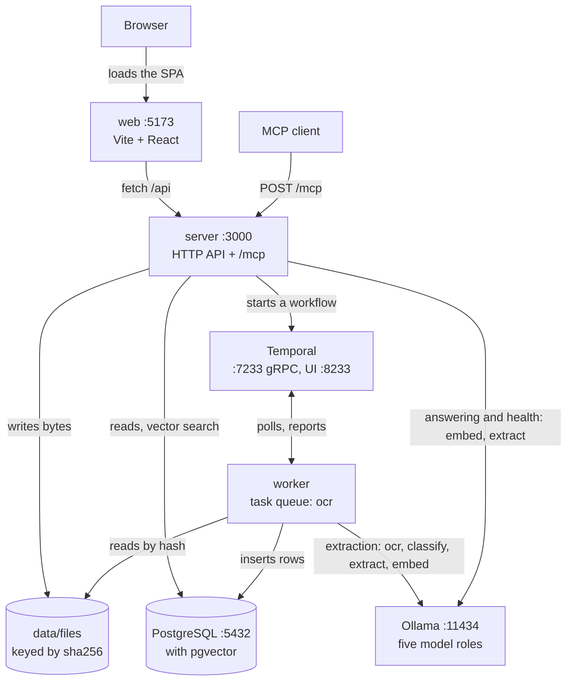
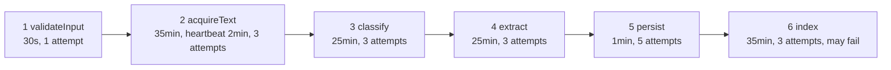
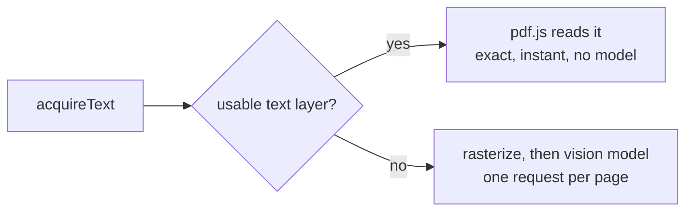
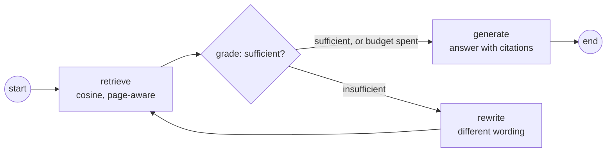

# Architecture

What runs where, and what happens to a document between upload and review.

A hand-drawn version of these diagrams, with more detail and the defect history,
is in [`architecture.html`](architecture.html) — GitHub renders HTML as source,
so open that file locally. This page is the one to read online, and the two say
the same thing.

---

## Processes and ports

Everything except the models runs on one machine, and the browser never reaches
Postgres or Temporal directly.

Model calls split between the two processes, and the split is the design.
**Extraction runs in the worker**, so every model call in it is a Temporal
activity and survives a crash. **Answering a question runs in the server**,
in-process and without durability, because a failed answer costs one retry by
the person who asked. The server also pings a provider for the health indicator
and sends a probe request when you press Test on the system page.

In a built deployment the server also serves the interface, so the UI, the REST
API and the MCP endpoint share **one** port. Vite's 5173 exists only in
development.

| Port | Process | Yours |
|---|---|---|
| 3000 | API, MCP and the built UI | yes |
| 5173 | Vite dev server | yes, development only |
| 5432 | PostgreSQL + pgvector | dependency |
| 7233 | Temporal frontend (gRPC only) | dependency |
| 8233 | Temporal web console | dependency |
| 11434 | Ollama, local or on the LAN | dependency |

---

## One document, end to end

Upload returns a run id, not a result. The server hashes the bytes, writes them
to disk, checks whether that hash is already stored, and starts a workflow named
`extract-<first 16 of sha256>` — content-addressed, so the same PDF cannot race
itself.

Per-step policy rather than one global retry, because the steps differ by two
orders of magnitude. The heartbeat on steps 2 and 6 is what makes a killed
worker detectable in two minutes instead of thirty-five (`D-013`); steps 3 and 4
are single model calls that cannot report progress, so they get no heartbeat at
all. An indexing failure is caught — a document that extracted but could not be
embedded is still useful.

---

## Where the text comes from

`OCR_TEXT_MODE=auto` takes the text layer when a page has one. Run 008 measured
why that matters: three vision models all read a digital invoice worse than the
text layer already inside it.

The decision lives inside the activity because it needs to read the file; the
workflow only learns that text came back.

---

## Asking a document a question

Extraction is a fixed sequence. Answering is a loop whose next step depends on a
model's judgement, so it is the one place where a model decides control flow.

It runs **in the server process**, not the worker: there is no durability here
and none is wanted, because a failed answer costs one retry by the person who
asked rather than a lost document.

Grading is strict on purpose: partial relevance counts as insufficient, because
one more search is cheaper than an answer the document does not support. When
the rewrite budget runs out it answers anyway and says the sources may not cover
it. If the model names no sources, every retrieved page is cited — a citation
that is too broad can still be checked.

---

## Where each idea lives

| | File |
|---|---|
| Durability | [`worker/src/workflows.ts`](../packages/worker/src/workflows.ts), [`activities.ts`](../packages/worker/src/activities.ts) |
| Retrieval loop | [`core/src/qa/graph.ts`](../packages/core/src/qa/graph.ts) |
| Chunking and embedding | [`core/src/rag/`](../packages/core/src/rag/) |
| Agent surface | [`server/src/mcp.ts`](../packages/server/src/mcp.ts) |
| Extraction steps | [`core/src/pipeline/`](../packages/core/src/pipeline/) |
| Guards | [`core/src/guards/`](../packages/core/src/guards/) |
| Plausibility checks | [`shared/src/documents/checks.ts`](../packages/shared/src/documents/checks.ts) |
| A document type | [`documents/<type>/`](../documents/) + a schema and a registry entry |

**The structural rule:** `packages/core` imports nothing from Express, Postgres
or any orchestrator. Given bytes and a model binding it returns a result — which
is what lets the interface, the agent surface and the evaluation harness share
one engine rather than drifting into three.
